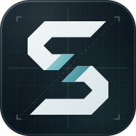

<p align="center">
  
</p>

<h1 align="center">Sovereign</h1>

<p align="center">An open-source, provider-agnostic Commercial Operating System for running governed AI ventures on top of your existing subscriptions.</p>

<p align="center">
  <a href="./docs/sovereign/quickstart.md"><strong>Quickstart</strong></a> ·
  <a href="./docs/sovereign/architecture.md">Architecture</a> ·
  <a href="./docs/sovereign/providers-and-pool.md">Provider Pool</a> ·
  <a href="./docs/sovereign/ventures.md">Ventures</a> ·
  <a href="./docs/sovereign/integrations.md">Integrations</a> ·
  <a href="./docs/sovereign/governance-and-finance.md">Governance & Finance</a> ·
  <a href="./docs/README.md">All Docs</a>
</p>

---

**Sovereign** turns a local multi-agent runtime into a governed commercial operating system. You connect the AI subscriptions, local models, or developer tools you already pay for, define ventures and natural-language commercial objectives, and let Sovereign plan, score, execute, and track work across software bounties, agencies, voice desks, digital products, micro-SaaS, and custom business models — while keeping **every external action, penny of spend, security scope, and client message behind application-enforced permissions and a GBP-default ledger**.

> **Independent project & upstream attribution:** Sovereign is an independent, unofficial project built on the MIT-licensed [T3 Code](https://github.com/pingdotgg/t3code) source code (`Copyright (c) 2026 T3 Tools Inc.`). Sovereign is **not** affiliated with, endorsed by, sponsored by, or maintained by T3 Tools, Inc. See [License & Attribution](#license-and-upstream-attribution) and [TRADEMARK.md](./TRADEMARK.md).

---

## Architecture & Relationship to T3 Code

Sovereign is built as a **modular commercial layer** on top of T3 Code's local-first Node/Effect WebSocket server, SQLite persistence (`statev2.sqlite`), git worktree orchestration, provider adapters, and web/desktop/mobile clients:

- **Wire Contracts ([`packages/contracts/src/sovereign/`](./packages/contracts/src/sovereign/)):** Effect Schemas for ventures, objectives, opportunities, tasks, artifacts, CRM/sales, double-entry ledger entries, governance approvals, provider pool metadata, 36 `sovereign.*` WebSocket RPCs, and 4 granular auth scopes (`sovereign:read`, `sovereign:operate`, `sovereign:approve`, `sovereign:admin`).
- **Persistence ([`117_sovereign_commercial_os.ts`](./apps/server/src/persistence/Migrations/117_sovereign_commercial_os.ts)):** SQLite Migration 117 adds 21 Sovereign tables without altering upstream Migrations `001..116`. Starts clean with zero fabricated ventures or simulated revenue.
- **Server Services ([`apps/server/src/sovereign/`](./apps/server/src/sovereign/)):** Typed Effect services (`SovereignStore`, `SovereignGovernanceService`, `SovereignLedgerService`, `SovereignSalesService`, `SovereignIntegrationService`, `SovereignOrchestratorService`, and `VentureWorkflowEngine`), live `sovereign.subscribe` event streaming, HMAC-verified inbound webhooks (`POST /api/sovereign/webhooks/:integrationId`), and a 6-tool least-privilege MCP toolkit ([`apps/server/src/mcp/toolkits/sovereign.ts`](./apps/server/src/mcp/toolkits/sovereign.ts)).
- **Shared Client Runtime ([`packages/client-runtime/src/sovereign/`](./packages/client-runtime/src/sovereign/)):** Live subscription atoms, permission-gated RPC commands, and Hermes-safe formatters shared across web, desktop, and mobile.
- **[Overview and venture workspaces](./docs/sovereign/quickstart.md)** — The Overview shows net profit for Today (UTC), the trailing 7 or 30 days, or all time. Open a venture card to continue its linked conversation, or select its sidebar project to review approvals and manage the venture. Hover over **Providers** for subscription usage, or select it to open provider settings.
- **Floating composer** — Enter a commercial objective with an open-ended horizon and zero discretionary spend. Dictate with the microphone, or select a model and attach files to continue in a standard thread draft. The thread composer handles uploads, model capabilities and final submission.

Read the full breakdown in [Architecture](./docs/sovereign/architecture.md).

---

## Provider-Agnostic Resource Pool

Sovereign does not resell tokens or lock you into one vendor. It pools all authenticated local CLIs, managed runtimes, local inference servers, and ACP agents via [`ProviderPoolRouter`](./apps/server/src/provider/ProviderPoolRouter.ts), [`ProviderAvailabilityLedger`](./apps/server/src/provider/ProviderAvailabilityLedger.ts), and [`billingClassifier.ts`](./apps/server/src/provider/billingClassifier.ts):

| Execution Mechanism                      | Drivers                                                                                                                                                      | Billing Classification                                                                                    | Notes                                                                                                                                   |
| ---------------------------------------- | ------------------------------------------------------------------------------------------------------------------------------------------------------------ | --------------------------------------------------------------------------------------------------------- | --------------------------------------------------------------------------------------------------------------------------------------- |
| **Subscription CLIs / Managed Runtimes** | Codex (`codex`), Claude Code (`claudeAgent`), Antigravity/Gemini (`antigravity`), Cursor (`cursor`), Grok Build (`grok`), Muse Code (`muse`)                 | `subscription` (automatically switches to `metered_api` if API key / Bedrock / Vertex config is detected) | Multi-instance support per driver with priority, concurrency caps, tags, and model tiers (`fast`, `balanced`, `reasoning`, `frontier`). |
| **Multi-Backend & ACP Agents**           | OpenCode (`opencode`), Kiro (`kiro`), Pi (`pi`), fx (`fx`), ACP Registry (`acpRegistry` — e.g. **GitHub Copilot CLI**, **Devin**, or **Local ACP commands**) | `unknown` by default (`local` for local ACP commands without API keys; `metered_api` if API keys are set) | Conservatively treats `unknown` as metered until explicitly classified by the owner to prevent silent API spend.                        |
| **Local Models**                         | Any driver pointing at `localhost` / `127.0.0.1` / `*.local` / `OLLAMA_HOST` / `LM_STUDIO_BASE_URL` / `VLLM_BASE_URL`                                        | `local`                                                                                                   | Zero marginal API cost.                                                                                                                 |
| **Free / Dev Testing**                   | `Replay (dev)` (`devReplay`)                                                                                                                                 | `free`                                                                                                    | Deterministic local ACP transcript replayer registered automatically in `vp run dev`.                                                   |
| **Web-Only Subscriptions**               | Consumer web-chat plans without an official CLI, SDK, or ACP transport                                                                                       | `manual_only`                                                                                             | Excluded from automated routing; Sovereign never scrapes consumer chat UIs.                                                             |

Key pool guarantees:

- **Never silent paid fallback:** Global and per-venture `paidFallbackMode` defaults to **`deny`**. Paid/metered instances are never used automatically unless you switch to `ask_approval` (queues a high-risk approval request) or `allow` (enforces `maxEstimatedCostMinor`).
- **Honest quota reporting:** If a provider does not expose live quota telemetry, Sovereign reports `Unavailable` (`quotaRemainingPct: null`) instead of inventing percentages.
- **Rate-limit cooldown & safe reassignment:** Rate-limited instances enter cooldown (`resetAt` or bounded 30s–15m exponential backoff) and [`UsageLimitRecoveryWorker`](./apps/server/src/orchestration-v2/UsageLimitRecoveryWorker.ts) reassigns work only to healthy peers in the **same or cheaper** billing class.

See [Providers and Resource Pool](./docs/sovereign/providers-and-pool.md).

---

## Business Ventures (7 Initial + Dynamic Expansion)

Sovereign ships with 7 structured venture blueprints ([`SovereignBlueprints.ts`](./apps/server/src/sovereign/SovereignBlueprints.ts), [`VentureWorkflowEngine.ts`](./apps/server/src/sovereign/ventures/VentureWorkflowEngine.ts)) and supports creating arbitrary new ventures dynamically at runtime without code changes:

1. **Development Bounties (`dev_bounties`):** Discovers funded GitHub issues, checks `CONTRIBUTING.md` AI-contribution rules (disqualifying prohibited repos), detects competing PRs, builds test-verified patches in isolated worktrees, and gates external PR submission.
2. **Authorised Security Bug Bounties (`security_bounties`):** Strictly separate from dev bounties. Hard-locked (`security_testing: "deny"`, `authorised: false`) until the owner records explicit programme authorisation, `targetScope`, `permittedMethods`, and expiry.
3. **Website & Software Agency (`web_agency`):** SSRF-safe prospect website audits, personalised demos/proposals with quote & discount caps, UK PECR/GDPR consent-verified outreach, staging previews, approval-gated deployments, and invoicing.
4. **Voice AI & Customer Support (`voice_ai`):** Vendor-agnostic voice receptionists/support agents across Vapi, Retell AI, ElevenLabs, and Twilio with mandatory AI identity greeting, recording disclosure, opt-out/escalation paths, and explicit per-minute telephony cost logging.
5. **Paid Tasks & Online Work (`paid_tasks`):** Partitions tasks strictly into AI-permitted, assisted-review, human-required, and ineligible queues. Zero human impersonation or verification bypassing.
6. **Digital Products (`digital_products`):** Demand-validation gate before asset production, packaging, approval-gated storefront listing (Gumroad, Lemon Squeezy, Stripe, Paddle), and fee reconciliation.
7. **Micro-SaaS Studio (`micro_saas`):** Willingness-to-pay validation gate, lean engineering pipeline, approval-gated deployments/billing changes, and verified MRR/hosting/unit-economics tracking.
8. **Dynamic Custom Ventures (`custom`):** Propose and instantiate new business models from commercial objectives via [`customVenture.ts`](./apps/server/src/sovereign/ventures/customVenture.ts) or the **New Venture** dialog with custom UI modules and conservative default guardrails.

See [Ventures](./docs/sovereign/ventures.md).

---

## Installation & Quickstart

### Prerequisites

- **Git** (on Windows, clone with `git clone -c core.longpaths=true ...`)
- **[Vite+](https://viteplus.dev/guide/) (`vp`)** — manages the pinned Node.js version:

```bash
# macOS / Linux
curl -fsSL https://vite.plus | bash
```

```powershell
# Windows (PowerShell)
irm https://vite.plus/ps1 | iex
```

### Run locally

```bash
vp i
cp .env.example .env   # optional local overrides (keep SOVEREIGN_HOME isolated)
vp run dev
```

Open the `pairingUrl:` printed in your terminal. To launch the Electron desktop wrapper instead:

```bash
vp run dev:desktop
```

To isolate Sovereign's database and secrets from any existing T3 Code installation, set `SOVEREIGN_HOME` (for example, `SOVEREIGN_HOME=~/.sovereign`). Never point a dev server at a live `~/.t3/userdata` directory.

See [Quickstart](./docs/sovereign/quickstart.md) and [Install](./docs/user/install.md).

---

## Configuring AI Subscriptions & Commercial Integrations

### AI Providers

Authenticate your chosen CLIs on the host machine (`claude auth login`, `codex login`, `agent login`, `grok login`, `opencode auth login`, `kiro-cli login`, etc.), then enable instances and set billing classes/priorities in **Settings → Providers**.

### External Commercial Integrations

Configure credentials in **Settings → Integrations** (`/settings/sovereign-integrations`):

- **Payments:** Stripe, Paddle, Lemon Squeezy (constant-time HMAC webhook verification + replay deduplication → verified GBP ledger reconciliation)
- **Email:** Resend, SMTP (enforces AI identity disclosure + UK PECR/GDPR consent/opt-out)
- **Voice & Telephony:** Vapi, Retell AI, ElevenLabs, Twilio
- **Source Control & Hosting / Storefronts:** GitHub, Vercel, Cloudflare, Gumroad, plus generic HMAC webhooks

All credentials are stored in server-side `ServerSecretStore` (`0o600`) or an external vault `SecretReference` — never returned in plaintext over RPC or exposed to agents via MCP. See [Integrations](./docs/sovereign/integrations.md).

---

## Governance, Emergency Stop & Financial Controls

- **13 gated action categories:** External communications, submissions, deployments, expenditures, payments, contracts, refunds, personal data, and new venture creation default to `require_approval`; `security_testing` and `paid_provider_fallback` default to `deny`.
- **Global Emergency Stop:** Persisted in SQLite (`sovereign_control_state`), immediately pauses all active tasks, and blocks all external actions and approvals until explicitly cleared.
- **Prompt-injection quarantine:** Untrusted external inputs (issues, web pages, programme policies) are scanned and sanitized before orchestration; all enforcement lives in server-side Effect services, not prompts.
- **GBP-default ledger & £0.00 default budget:** Both global and per-venture monthly spend caps default to `£0.00` (`discretionarySpendAllowed: false`). Verified ledger totals are strictly isolated from pipeline estimates, pending reconciliation, and `[Simulated]` fixtures.

See [Governance and Finance](./docs/sovereign/governance-and-finance.md).

---

## Runtime Operation, Recovery & Testing

- **Background daemon:** Run headless with `t3 serve` or install as a user service (`t3 service install` / `status` / `restart` / `uninstall`) using `systemd` (Linux), `launchd` (macOS), or Task Scheduler (Windows).
- **Crash recovery:** On every boot, `SovereignRuntimeLayer.layerStartupRecovery` recovers interrupted `running`/`queued` tasks with preserved checkpoints and retry budgets while enforcing idempotency keys across tasks, opportunities, approvals, ledger entries, and webhooks.
- **Offline verification:** Run deterministic Sovereign tests without paid APIs:

```bash
vp test run \
  packages/contracts/src/sovereign/sovereign.test.ts \
  packages/client-runtime/src/sovereign/sovereign.test.ts \
  apps/server/src/provider/billingClassifier.test.ts \
  apps/server/src/provider/ProviderPoolRouter.test.ts \
  apps/server/src/sovereign/SovereignCore.test.ts \
  apps/server/src/sovereign/integrations/IntegrationsHub.test.ts \
  apps/server/src/sovereign/ventures/VentureWorkflowEngine.test.ts \
  apps/web/src/sovereign/sovereignUi.test.ts
```

See [Operations and Reliability](./docs/sovereign/operations-and-reliability.md).

---

## Known Limitations & External Requirements

- **User-supplied credentials required:** All 13 commercial integration drivers and HMAC webhook verifiers are tested offline against deterministic mock transports. Live commercial operations require your own accounts, API keys, webhook signing secrets, and (for inbound webhooks) a publicly reachable HTTPS endpoint.
- **No hosted Sovereign cloud or store binaries:** Sovereign does not connect to T3 Tools' hosted `relay.t3.codes`, `app.t3.codes`, or Clerk instances. Build and run locally or operate your own relay.
- **Web-only AI plans are manual-only:** Subscriptions without a CLI, SDK, or ACP interface cannot be automated.
- **Provider quota telemetry varies:** Providers that do not report live usage windows display `Unavailable` rather than fabricated estimates.
- **External marginal costs apply to telephony and hosting:** Voice AI minutes, cloud hosting, domains, and payment processing carry real third-party vendor fees.

---

## License and Upstream Attribution

- **Source code license:** MIT License — see [LICENSE](./LICENSE).
- **Upstream attribution:** Sovereign is derived from **T3 Code** (`Copyright (c) 2026 T3 Tools Inc.`, MIT License, [github.com/pingdotgg/t3code](https://github.com/pingdotgg/t3code)) and its original contributors.
- **Non-affiliation:** Sovereign is an independent, unofficial project and is **not** affiliated with, endorsed by, sponsored by, or maintained by T3 Tools, Inc. All T3 Code trademarks, logos, wordmarks, domains, and store listings remain the property of T3 Tools, Inc. See [TRADEMARK.md](./TRADEMARK.md).
