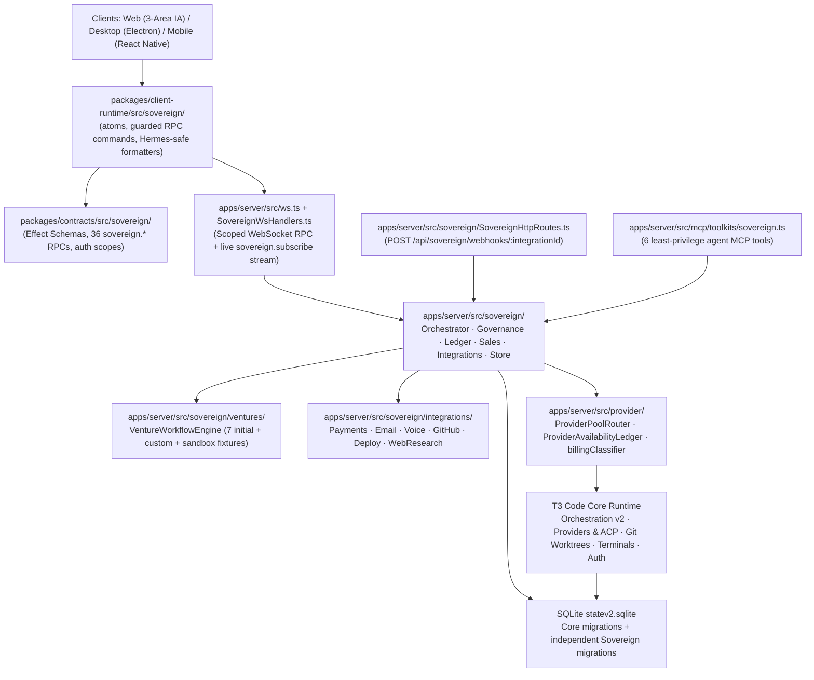

# Sovereign Architecture

Sovereign is structured as a modular **Commercial OS layer** built directly on top of the MIT-licensed T3 Code runtime core. The design avoids scattering business logic into T3 Code's low-level orchestration, terminal, git, or provider transport layers so upstream improvements remain easy to integrate and existing technical invariants hold across web, desktop, and mobile surfaces.

## 1. Layer Separation & Upstream Compatibility

Sovereign preserves the internal compatibility boundaries of T3 Code so client/server protocols, SQLite migration history, and workspace packages remain stable:

- **Rebranded user-facing identity:** Product name (`Sovereign`), Dual-Plane Meridian visual mark (`assets/{prod,nightly,dev}/`), Obsidian/Alabaster Meridian theme preset (`"sovereign"` in [`packages/shared/src/themePalettes.ts`](../../packages/shared/src/themePalettes.ts)), web/desktop/mobile metadata, installers, and legal/attribution screens.
- **Preserved internal runtime primitives:** `@t3tools/*` workspace package scopes, `statev2.sqlite` migration lineage (`001`..`116` untouched; Sovereign begins at `117`), `WS_METHODS`, `CLIENT_GUARDED_RPC_SCOPES`, Effect service tags, `t3` CLI compatibility, and `t3.json` project config.
- **Dedicated Sovereign directories:**
  - Wire contracts: [`packages/contracts/src/sovereign/`](../../packages/contracts/src/sovereign/) (exported via `@t3tools/contracts` and `@t3tools/contracts/sovereign`)
  - Shared client runtime: [`packages/client-runtime/src/sovereign/`](../../packages/client-runtime/src/sovereign/) (`atoms.ts`, `commands.ts`, `format.ts`)
  - Server domain services: [`apps/server/src/sovereign/`](../../apps/server/src/sovereign/)
  - Provider pool routing: [`apps/server/src/provider/ProviderPoolRouter.ts`](../../apps/server/src/provider/ProviderPoolRouter.ts), [`ProviderAvailabilityLedger.ts`](../../apps/server/src/provider/ProviderAvailabilityLedger.ts), [`billingClassifier.ts`](../../apps/server/src/provider/billingClassifier.ts)
  - Web UI: [`apps/web/src/sovereign/`](../../apps/web/src/sovereign/) and [`apps/web/src/state/sovereign.ts`](../../apps/web/src/state/sovereign.ts)

## 2. Persistence: The Sovereign schema migration

[`apps/server/src/sovereign/migrations/001_CommercialOS.ts`](../../apps/server/src/sovereign/migrations/001_CommercialOS.ts) adds 21 normalized tables to `statev2.sqlite` (registered in [`apps/server/src/persistence/Migrations.ts`](../../apps/server/src/persistence/Migrations.ts)):

| Group                   | Tables                                                                                                                                                                 | Key invariants                                                                                                                                                                                                                                                      |
| ----------------------- | ---------------------------------------------------------------------------------------------------------------------------------------------------------------------- | ------------------------------------------------------------------------------------------------------------------------------------------------------------------------------------------------------------------------------------------------------------------- |
| Control & Governance    | `sovereign_control_state`, `sovereign_approvals`, `sovereign_preapproval_policies`, `sovereign_audit_events`                                                           | Singleton `id = 'global'` seeded at `GBP`, £0 monthly budget, `emergency_stop_active = 0`, `default_paid_fallback_mode = 'deny'`, prompt-injection guard enabled. `sovereign_audit_events` is append-only; `sovereign_approvals` enforces unique `idempotency_key`. |
| Ventures & Execution    | `sovereign_ventures`, `sovereign_objectives`, `sovereign_opportunities`, `sovereign_tasks`, `sovereign_artifacts`                                                      | Unique `(venture_id, external_id)` on opportunities; unique `idempotency_key` on tasks plus checkpoint, handoff summary, dependency list, and retry counters (`retry_count`, `max_retries`, `next_retry_at`).                                                       |
| CRM, Sales & Voice      | `sovereign_leads`, `sovereign_customers`, `sovereign_proposals`, `sovereign_orders`, `sovereign_communications`, `sovereign_support_tickets`, `sovereign_voice_agents` | Persists UK PECR/GDPR `consents_json`, `ai_disclosed` and `consent_verified` flags, and voice disclosure/opt-out settings.                                                                                                                                          |
| Finance                 | `sovereign_invoices`, `sovereign_payment_links`, `sovereign_ledger_entries`                                                                                            | `sovereign_ledger_entries` is append-only with unique `external_ref` deduplication, integer minor units, GBP conversion snapshot, and explicit `verification_state` (`verified`, `pending_reconciliation`, `simulated_fixture`).                                    |
| Integrations & Webhooks | `sovereign_integrations`, `sovereign_webhook_replay_keys`                                                                                                              | Never stores plaintext secrets (only `has_secret` + optional `secret_reference_json`); primary key `(integration_id, replay_key)` prevents webhook replay double-booking.                                                                                           |

The schema starts with an empty ledger and no ventures or tasks. Sovereign records its migration in `sovereign_sql_migrations`. Existing installations that used upstream migration number 117 keep their commercial tables and receive the upstream workflow-mail change during upgrade.

## 3. Server Effect Services

All Sovereign server logic is implemented as typed Effect services following [`docs/internals/02_effect-services.md`](../internals/02_effect-services.md) and composed in [`apps/server/src/sovereign/SovereignRuntimeLayer.ts`](../../apps/server/src/sovereign/SovereignRuntimeLayer.ts):

- **`SovereignStore`** ([`SovereignStore.ts`](../../apps/server/src/sovereign/SovereignStore.ts)): SQLite queries, transactional helpers, and a `PubSub<SovereignEvent>` broadcasting live mutations to connected clients.
- **`SovereignGovernanceService`** ([`SovereignGovernanceService.ts`](../../apps/server/src/sovereign/SovereignGovernanceService.ts)): Single enforcement choke point for external actions (`assertAndGateExternalAction`), emergency stop, preapproval matching, approval queueing/decisions, prompt-injection quarantine (`sanitizeUntrustedContent`), and immutable audit logging.
- **`SovereignLedgerService`** ([`SovereignLedgerService.ts`](../../apps/server/src/sovereign/SovereignLedgerService.ts)): Integer minor-unit multi-currency accounting (GBP default), idempotent `externalRef` deduplication, invoice reconciliation, detailed cost breakdowns, and strict isolation of pipeline estimates vs. verified totals vs. simulated fixtures.
- **`SovereignSalesService`** ([`SovereignSalesService.ts`](../../apps/server/src/sovereign/SovereignSalesService.ts)): Lead/customer/proposal/order/ticket/voice-agent management with PECR/GDPR opt-out/consent enforcement, mandatory AI disclosure, and proposal quote/discount approval routing.
- **`SovereignIntegrationService`** ([`SovereignIntegrationService.ts`](../../apps/server/src/sovereign/SovereignIntegrationService.ts)): Credential isolation via `ServerSecretStore` (`sovereign-integration-<id>.bin`), pluggable `SovereignIntegrationDriver` registry, connection probing, constant-time HMAC-SHA256 verification, and replay-protected webhook ingestion.
- **`SovereignOrchestratorService`** ([`SovereignOrchestratorService.ts`](../../apps/server/src/sovereign/SovereignOrchestratorService.ts)): Venture CRUD, natural-language objective decomposition, deterministic opportunity scoring, startup interrupted-task recovery (`recoverInterruptedWork`), portfolio recommendations, and delegation of provider pool snapshots/routing to `ProviderPoolRouter`.
- **`VentureWorkflowEngine`** ([`ventures/VentureWorkflowEngine.ts`](../../apps/server/src/sovereign/ventures/VentureWorkflowEngine.ts)): Domain workflows for all 7 initial ventures, dynamic custom venture generation, and opt-in sandbox fixtures.

## 4. Transports, Auth Scopes & Agent MCP Toolkit

### WebSocket RPC & Authorization Scopes

[`packages/contracts/src/auth.ts`](../../packages/contracts/src/auth.ts) defines four granular scopes enforced server-side in [`apps/server/src/auth/RpcAuthorization.ts`](../../apps/server/src/auth/RpcAuthorization.ts) and mirrored in `CLIENT_GUARDED_RPC_SCOPES` ([`packages/contracts/src/clientRpcPermissions.ts`](../../packages/contracts/src/clientRpcPermissions.ts)):

| Scope               | Methods                                                                                                                                                                                                                                                                                   |
| ------------------- | ----------------------------------------------------------------------------------------------------------------------------------------------------------------------------------------------------------------------------------------------------------------------------------------- |
| `sovereign:read`    | `sovereign.subscribe` (live snapshot + event stream), `sovereign.getOverview`, `sovereign.getVentureDetail`, `sovereign.listBlueprints`, `sovereign.listLedgerEntries`, `sovereign.listApprovals`, `sovereign.listAuditEvents`, `sovereign.getProviderPool`, `sovereign.listIntegrations` |
| `sovereign:operate` | Venture, objective, opportunity, task, artifact, lead, proposal, communication, voice agent, invoice, ledger entry, approval request, and provider route mutations (18 methods)                                                                                                           |
| `sovereign:approve` | `sovereign.decideApproval`, `sovereign.upsertPreapprovalPolicy`, `sovereign.deletePreapprovalPolicy`                                                                                                                                                                                      |
| `sovereign:admin`   | `sovereign.updateControlState`, `sovereign.triggerEmergencyStop`, `sovereign.upsertIntegration` (also requires `providers:manage` when attaching a `SecretReference`), `sovereign.deleteIntegration`, `sovereign.testIntegration`, `sovereign.updateProviderPoolConfig`                   |
| `providers:manage`  | `server.upsertProviderInstance`, `server.removeProviderInstance`                                                                                                                                                                                                                          |

### Inbound HTTP Webhooks

[`apps/server/src/sovereign/SovereignHttpRoutes.ts`](../../apps/server/src/sovereign/SovereignHttpRoutes.ts) exposes `POST /api/sovereign/webhooks/:integrationId` with a 1 MiB body ceiling, `cache-control: no-store`, raw-byte HMAC signature verification before parsing, and database-enforced replay key deduplication.

### Least-Privilege MCP Toolkit

[`apps/server/src/mcp/toolkits/sovereign.ts`](../../apps/server/src/mcp/toolkits/sovereign.ts) exposes 6 bounded tools to agents through `McpToolAccess`:

- **Reads:** `sovereign_get_overview`, `sovereign_get_venture`, `sovereign_list_opportunities`
- **Writes:** `sovereign_record_opportunity`, `sovereign_create_artifact`, `sovereign_request_approval`

Agents cannot directly approve their own actions, toggle emergency stop, modify budgets, alter security scope authorisations, or read stored integration secrets via MCP.

## 5. Client Runtime & 3-Area UI

- **`packages/client-runtime/src/sovereign/`** provides shared query atoms (`atoms.ts`), permission-gated commands (`commands.ts`), and Hermes-safe currency/quota/label formatters (`format.ts`) for web, desktop, and mobile clients. `sovereignEventsSubscriptionAtomFamily` subscribes to `sovereign.subscribe` and refreshes affected queries on live server events without polling.
- **`apps/web/src/sovereign/`** organizes the interface into three restrained areas:
  1. **Overview (`/`, `/overview`):** A period-filtered verified profit control, linked venture cards, project navigation, a provider usage popover, emergency stop and a floating composer. Venture management holds per-venture objectives and approvals. Governance settings holds the audit timeline.
  2. **Venture Workspaces (`/ventures/:ventureId`):** Tailored commercial workspace per venture kind (`VentureCommercialPanel`), operations/artifacts/approvals (`VentureOperationsPanel`), finances & budget bar (`VentureFinancesPanel`), linked projects & T3 Code thread drill-down (`VentureWorkspacePanel`), and policy/budget drawer (`VentureConfigSheet`).
  3. **Consolidated Settings:** Providers & Resource Pool (`SovereignProviderPoolSection`), Integrations (`/settings/sovereign-integrations`), Governance & Security (`/settings/governance`), Budgets & Ledger (`/settings/budgets`), and Appearance (`sovereignAtmosphere`: `ambient`, `subtle`, or `off`).
- **Discreet Technical Drawer:** The sidebar keeps T3 Code's full project/thread/terminal workspace accessible inside a collapsed **Workspaces & Threads** drawer so deep engineering work remains one click away without cluttering commercial overview screens.
